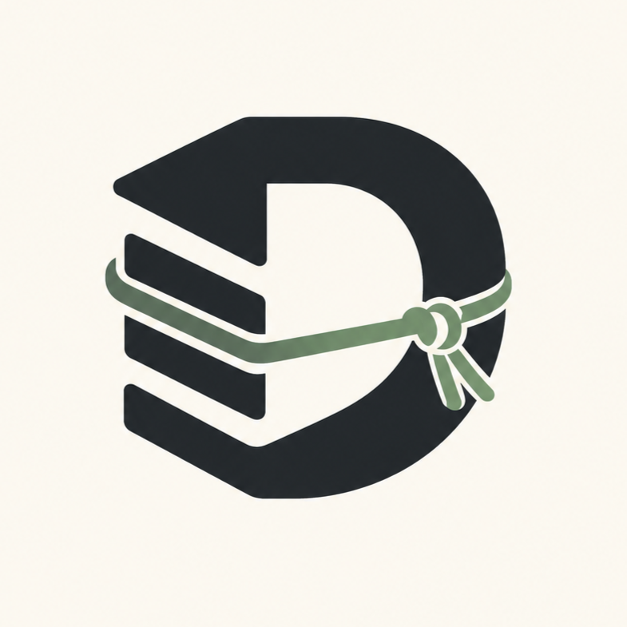

# Damodara 🛡️

<p align="center">
  
</p>

<p align="center">
  <strong>Automated, safe, scheduled backups for Minecraft Paper servers with Google Drive off-site cloud synchronization.</strong>
</p>

---

> [!NOTE]
> **Target Platform & Verification Context:**  
> Damodara targets **Paper 26.2** running on **Java 25**.
> The Google OAuth integration is configured as **External** and **In Production** with verified **Damodara** branding shown to users, requesting strictly the `https://www.googleapis.com/auth/drive.file` scope. Live backups are non-blocking and safe for production environments.

---

## Table of Contents
1. [Overview & Product Goal](#overview--product-goal)
2. [Point-in-Time Snapshots vs. Best-Effort Live Copy](#point-in-time-snapshots-vs-best-effort-live-copy)
3. [File Inclusion & Exclusion Rules](#file-inclusion--exclusion-rules)
4. [Backup Staging, Integrity & Retention](#backup-staging-integrity--retention)
5. [Google Drive OAuth 2.0 Device Flow Architecture](#google-drive-oauth-20-device-flow-architecture)
   - [Headless VPS Device Flow (RFC 8628)](#headless-vps-device-flow-rfc-8628)
   - [Required OAuth Client Type: TVs and Limited Input Devices](#required-oauth-client-type-tvs-and-limited-input-devices)
   - [Public Client Model & App-Level Credentials](#public-client-model--app-level-credentials)
   - [Simple Credential Storage & Security Tradeoff](#simple-credential-storage--security-tradeoff)
   - [Production Status & Verified Branding](#production-status--verified-branding)
   - [OAuth Scope & Security Model](#oauth-scope--security-model)
6. [Connecting Google Drive: One Console Command](#connecting-google-drive-one-console-command)
   - [Step-by-Step Linking Flow](#step-by-step-linking-flow)
   - [Disconnecting & Revoking Authorization](#disconnecting--revoking-authorization)
   - [Optional: Using a Custom Google Cloud Project](#optional-using-a-custom-google-cloud-project)
7. [Scheduled Backup Enable/Disable](#scheduled-backup-enabledisable)
8. [Target Platform & Java Requirements](#target-platform--java-requirements)
9. [Commands & Permissions](#commands--permissions)
10. [Configuration Reference (`config.yml`)](#configuration-reference-configyml)
11. [Legacy Damodar Migration](#legacy-damodar-migration)
12. [Critical Restore & Offline Recovery Advisory](#critical-restore--offline-recovery-advisory)
13. [Google OAuth Production Architecture](#google-oauth-production-architecture)
14. [Pre-Release Quality & Verification Checklist](#pre-release-quality--verification-checklist)
15. [License](#license)

---

## Overview & Product Goal

Running a Minecraft server involves critical state: world chunks, player inventories, plugin databases, and configuration files. Disasters such as host drive failures, corrupted worlds, or bad plugin migrations require reliable, off-site recovery.

**Damodara** provides:
- Automated, scheduled backups of the entire Minecraft server directory.
- Compression into standard `.zip` archives with configurable compression levels.
- Safe asynchronous execution: **never pauses, freezes, or halts the Minecraft server tick loop**, and **never disables auto-saving**.
- Robust path protection preventing recursive backup loops (e.g. backing up the backup directory into itself).
- Retention policies that **never delete the last remaining valid backup**.
- Resumable, chunked streaming uploads to Google Drive with automatic retry and exponential backoff.
- Local backup archives are **never deleted until Google Drive confirms upload completion**.
- **Headless console-driven Google Drive linking** designed for VPS hosting panels:
  - Run one command in the server console: `/damodara auth connect`.
  - Open Google's URL on your phone or PC, enter the code, and approve.
  - No companion apps, no SFTP file transfers, no copy-pasting tokens, and no mandatory environment variables.
- Runtime backup schedule enable/disable that persists across server restarts.

---

## Point-in-Time Snapshots vs. Best-Effort Live Copy

### Point-in-Time Snapshots
A true point-in-time filesystem snapshot (such as those provided by ZFS, Btrfs subvolumes, LVM, or Windows VSS) instantaneously freezes block-level storage. All files in the snapshot reflect the exact state at a single microsecond, guaranteeing transaction consistency across databases and world region files.

### Why Damodara Cannot Guarantee Universal Snapshots
A portable Java plugin running on arbitrary hosting platforms cannot guarantee hardware- or kernel-level snapshots because:
1. **Host Diversity:** Servers run on diverse environments ranging from standard Linux VPS (ext4/XFS filesystems without LVM), Docker/Pterodactyl containers, to shared game hosting panels.
2. **Privilege Boundaries:** Creating volume snapshots requires elevated operating system privileges (root or administrator access) or hypervisor APIs that game server processes must not possess.
3. **Storage Abstraction:** The standard Java Virtual Machine (`java.nio.file`) provides portable file I/O, not storage-layer snapshot commands.

### Best-Effort Live Copy (Default Behavior)
Because universal snapshots are impossible across all environments, Damodara implements a **safe, non-blocking live copy**:
- Traverses the server directory asynchronously using Java NIO (`Files.walkFileTree`).
- **Never pauses or halts server ticks.**
- **Never disables world auto-saving (`/save-off`).**

> [!WARNING]
> **Live Copy Consistency Notice:**  
> Because the server continues running and writing to disk while files are being read, files that are actively being modified (such as open SQLite database journals, player cache files, or log files) may change between the start and end of traversal. While world region files (`.mca`) are generally stable between chunk writes, live copying cannot guarantee transaction-level point-in-time consistency without host-level snapshot integration.

The codebase includes an extensible `SnapshotProvider` interface so that advanced hosting environments with ZFS or custom daemon integrations can mount consistent snapshots in future updates.

---

## File Inclusion & Exclusion Rules

Backups must never include their own destination directory, staging files, or volatile cache data that would cause archives to grow exponentially. Furthermore, OAuth credentials must never be included in local or cloud backup archives.

### Default Exclusions
| Pattern | Reason |
| :--- | :--- |
| `backups/**` | Backup destination directory (prevents recursive self-inclusion) |
| `.damodar_staging/**` | Temporary in-progress zip staging area |
| `plugins/Damodara/credentials/**` | OAuth tokens and credential files (**strictly excluded**) |
| `plugins/Damodara/credentials` | Credential directory itself |
| `plugins/Damodara/*.tmp` | Temporary credential write files |
| `plugins/Damodar/credentials/**` | Legacy credential path (excluded during migration) |
| `crash-reports/**` | Historical crash logs |
| `logs/*.log.gz` | Historical compressed server logs |
| `cache/**` | Paper and Mojang temporary download caches |
| `world*/session.lock` | Active server lock files (omitted to avoid lock contention) |
| `*.tmp` | Temporary working files |

> [!IMPORTANT]
> **Built-in Security Invariant:**  
> In addition to configurable glob rules, Damodara's internal file scanner (`LiveCopyBackupSource`) hardcodes an automatic exclusion of any file or directory under `plugins/Damodara/credentials/` or `plugins/Damodar/credentials/`, as well as any `.tmp` write files. Credentials are never collected or uploaded under any circumstances.

### Symbolic Links
By default, `storage.follow-symlinks` is set to `false`. Damodara ignores symbolic links during traversal to avoid directory loops, symlink attacks, and archiving external directories outside the server root.

---

## Backup Staging, Integrity & Retention

### Two-Phase Staging Architecture
To prevent incomplete or corrupted archives from masquerading as valid backups:
1. When a backup starts, files are compressed into a hidden staging file:  
   `backups/.damodar_staging/Damodara-<server>-<timestamp>.zip.tmp`
2. If compression completes without errors, an optional SHA-256 checksum and ZIP header verification check are executed.
3. The temporary file is atomically moved to the destination directory:  
   `backups/Damodara-<server>-<timestamp>.zip`
4. If any exception occurs during compression or verification, the `.tmp` staging file is deleted immediately.

### Retention Policy & Single Backup Invariant
Old backups are evaluated after every successful new backup:
- **Ordering Rule:** Completed backups are sorted by creation timestamp; the **oldest** backup is pruned first.
- **Max Count:** Keeps at most `retention.max-count` archives.
- **Max Age:** Deletes archives older than `retention.max-age-days`.

> [!IMPORTANT]
> **🛡️ The Single Backup Invariant:**  
> Damodara will **NEVER** delete the only remaining valid backup archive in the destination directory, regardless of age limits or count settings. At least one valid local archive is always safeguarded.

---

## Google Drive OAuth 2.0 Device Flow Architecture

### Headless VPS Device Flow (RFC 8628)
Many Minecraft servers run on headless Linux VPS instances or game hosting panels (e.g. Pterodactyl, Multicraft) where:
- There is no web browser installed on the server.
- The administrator only has access to the server console.
- Running companion tools or moving files via SFTP is cumbersome or restricted.

Damodara solves this by implementing the **OAuth 2.0 Device Authorization Grant (RFC 8628)**:
1. The administrator runs `/damodara auth connect` in the server console.
2. Damodara contacts Google's device authorization endpoint and receives a verification URL and temporary user code.
3. Damodara prints the URL and user code to the server console.
4. The administrator opens the URL on their phone, laptop, or desktop, signs into their Google account, enters the code, and approves access.
5. Damodara polls Google asynchronously in the background. Once approved, Google issues access and refresh tokens, which Damodara saves automatically.
6. The administrator never has to copy, paste, or upload tokens manually.

### Required OAuth Client Type: TVs and Limited Input Devices

> [!CAUTION]
> **OAuth Client Type Requirement:**  
> The Device Authorization Grant requires an OAuth 2.0 client registered for **"TVs and Limited Input devices"**.  
> Desktop clients and Web application clients **cannot** be used for device authorization; Google will reject them with `unauthorized_client`.

### Open Source Architecture & Build-Time Injection
Damodara is distributed as open-source software. To safeguard developer credentials while providing server owners with a seamless experience:
- **No Secrets in Tracked Code:** The client secret is **never** committed to version-controlled source files, `config.yml`, `README.md`, logs, chat, or help output.
- **Build Injection:** Release artifacts are built by injecting the app-level OAuth client credentials from a local, untracked `oauth.properties` file into `damodara-oauth.properties` in the JAR.
- **For Open-Source Contributors:** Contributors building their own copy of Damodara from source must copy `oauth.properties.example` to `oauth.properties` and supply their own "TVs and Limited Input devices" OAuth client credentials. If credentials are absent during a developer build, Damodara displays a clear setup error rather than using fake defaults.
- **Public Client Transparency:** In accordance with OAuth 2.0 standards, client secrets embedded in distributed client-side binaries are treated as public-client configuration. The client secret is extractable from distributed bytecode and does not protect user credentials.
- **User Privacy:** Users' personal access tokens and refresh tokens are **never** logged, printed, or displayed.

### Simple Credential Storage & Security Tradeoff
After successful approval, Damodara saves credentials under:
```
plugins/Damodara/credentials/credentials.json
```
- **Atomic Writes:** Credentials are written first to `credentials.json.tmp` and then atomically replaced (`Files.move(..., ATOMIC_MOVE)`), preventing corrupt writes during sudden server crashes.
- **Process-Owner File Permissions:** Where supported by the host operating system (POSIX filesystems such as Linux VPS), Damodara automatically sets directory permissions to `0700` (`rwx------`) and file permissions to `0600` (`rw-------`), restricting access strictly to the server process owner.
- **No Password Requirement:** Storing credentials without an encryption password enables headless VPS operation without requiring server owners to set environment variables or enter passwords on reboot.
- **Security Tradeoff Notice:**  
  > [!WARNING]
  > Because credentials are saved without an encryption passphrase, **anyone who has read access to the server host's filesystem (such as via FTP, panel file manager, or host shell) can access the saved Google connection**. Server administrators should restrict panel and FTP permissions, keep hosting accounts secure, and ensure the server directory is not exposed via a web server.
- **Revocation:** Run `/damodara auth disconnect` at any time to revoke the grant with Google and securely delete the credential file.

### Production Status & Verified Branding
- **External & In Production:** The Damodara OAuth application is registered as **External** and published **In Production**.
- **Verified Branding:** Google has officially verified the Damodara application name and branding, which is displayed to users during the device authorization grant.
- **Unrestricted Access:** Any valid Google account can link their Drive storage without needing to be pre-registered as a test user, and refresh tokens do not expire under the 7-day testing-mode limitation.

### OAuth Scope & Security Model
- Requested Scope: `https://www.googleapis.com/auth/drive.file`
- Damodara can **only** access files created by Damodara.
- Damodara **cannot** view, read, modify, or delete any existing documents, photos, or personal files in your Google Drive.

---

## Connecting Google Drive: One Console Command

### Server-Owner Experience (Zero-Setup)
Server owners using the official Damodara release do **not** need to create a Google Cloud project, enter OAuth client details, set environment variables, transfer token files, or enter their Google password or access token.

1. Open your server hosting panel or terminal console.
2. Run:
   ```
   > /damodara auth connect
   ```
3. Damodara displays:
   ```
   ================================================================
   [Damodara Auth] *** GOOGLE DRIVE DEVICE LINKING ***
   [Damodara Auth] Open this URL on any phone or computer:
   [Damodara Auth]   https://www.google.com/device
   [Damodara Auth] Then enter this code when prompted:
   [Damodara Auth]   ABCD-1234
   [Damodara Auth] This code expires in 30 minutes.
   [Damodara Auth] Waiting for approval in browser...
   ================================================================
   ```
4. On your phone, laptop, or desktop:
   - Visit `https://www.google.com/device`.
   - Sign into your Google account.
   - Enter the code displayed in the server console (e.g. `ABCD-1234`).
   - Click **Allow**.
5. Within seconds, Damodara detects approval in the background and prints:
   ```
   [Damodara Auth] Google Drive account successfully linked!
   Set google-drive.enabled: true in config.yml (if not already enabled) and run /damodara reload.
   ```
6. In `plugins/Damodara/config.yml`, set:
   ```yaml
   google-drive:
     enabled: true
   ```
7. Run `/damodara reload` in the console. Off-site cloud backups are now fully active!

### Disconnecting & Revoking Authorization
To unlink your Google Drive account, run in the **server console**:
```
> /damodara auth disconnect
```
Damodara contacts Google's revocation endpoint, revokes the token, and deletes `credentials.json` from disk.

### For Open-Source Contributors Building From Source
If you are compiling Damodara from source code rather than using a release binary:
1. Create a project in [Google Cloud Console](https://console.cloud.google.com/).
2. Enable the **Google Drive API**.
3. Create an OAuth client of type **"TVs and Limited Input devices"**.
4. Copy `oauth.properties.example` to `oauth.properties` in the project root:
   ```properties
   damodara.oauth.clientId=YOUR_CLIENT_ID.apps.googleusercontent.com
   damodara.oauth.clientSecret=YOUR_CLIENT_SECRET
   ```
5. Build the plugin with Gradle. The credentials are automatically injected into `damodara-oauth.properties` inside the JAR.
6. Alternatively, supply them at runtime via environment variables (`DAMODARA_GOOGLE_CLIENT_ID` and `DAMODARA_GOOGLE_CLIENT_SECRET`) or `config.yml`.

---

## Scheduled Backup Enable/Disable

Operators can toggle scheduled backups at runtime without restarting the server:

```
# Enable scheduled backups
/damodara backup on

# Disable scheduled backups  
/damodara backup off
```

These commands **persist across server restarts** in:
```
plugins/Damodara/schedule-enabled.dat
```
This file contains `enabled` or `disabled`. After first use, this persisted state overrides the default `schedule.enabled` in `config.yml`.

---

## Target Platform & Java Requirements

- **Server Platform:** Paper **26.2**
- **Java Runtime:** **Java 25** (mandated toolchain)
- **Dependency Coordinates:** `io.papermc.paper:paper-api:26.2.build.135-stable`
- **Plugin Type & Command Registration:** Declared as a `JavaPlugin` via `src/main/resources/plugin.yml` with `commands: damodara:` using standard `getCommand("damodara")` registration.

---

## Commands & Permissions

All commands use `/damodara` (alias: `/dm`). The primary permission is `damodara.admin` (defaults to operators).

| Command | Permission | Permitted Sender | Description |
| :--- | :--- | :--- | :--- |
| `/damodara` | `damodara.admin` | Any (OP) | Show safe command help. |
| `/damodara help` | `damodara.admin` | Any (OP) | Show help. Auth commands hidden from player view. |
| `/damodara backup now` | `damodara.backup` | Any (OP) | Trigger an immediate asynchronous backup. |
| `/damodara backup on` | `damodara.backup` | Any (OP) | Enable scheduled backups (persisted to disk). |
| `/damodara backup off` | `damodara.backup` | Any (OP) | Disable scheduled backups (persisted to disk). |
| `/damodara backups [page]` | `damodara.status` | Any (OP) | List local backup archives (sorted newest-first, 8 per page). |
| `/damodara status` | `damodara.status` | Any (OP) | Full status: scheduler, backup state, last run, and Drive sync. Never exposes credentials. |
| `/damodara reload` | `damodara.reload` | Any (OP) | Reload configuration safely. |
| `/damodara auth connect` | `damodara.auth` | **Server Console Only** | Start device-flow Google Drive linking. |
| `/damodara auth status` | `damodara.auth` | **Server Console Only** | Show Google Drive connection health (no tokens). |
| `/damodara auth disconnect` | `damodara.auth` | **Server Console Only** | Revoke authorization and remove credentials. |
| `/damodara restore` | `damodara.admin` | Any (OP) | Show offline restore guidance. |

> [!IMPORTANT]
> **Strict Console-Only Authentication Enforcement:**  
> All `/damodara auth ...` sub-commands are strictly restricted to the server console. Any attempt by players, command blocks, or remote entities to execute auth commands is immediately rejected without revealing verification codes, client information, or tokens. Tab completion and help text suppress auth suggestions for non-console senders.

---

## Configuration Reference (`config.yml`)

```yaml
schedule:
  enabled: true              # Default scheduled backup state (overridden by schedule-enabled.dat after first toggle)
  interval: 6                # Interval value
  interval-unit: "HOURS"     # MINUTES, HOURS, or DAYS
  run-on-startup: false      # Run a backup shortly after boot
  startup-delay-seconds: 60  # Wait time after startup before running

storage:
  source-directory: "."      # Root directory to back up (server directory)
  destination-directory: "backups" # Directory for completed archives
  follow-symlinks: false     # Follow symbolic links (default false for safety)

filters:
  excludes:                  # Glob patterns excluded from backup
    - "backups/**"
    - ".damodar_staging/**"
    - "plugins/Damodara/credentials/**"
    - "plugins/Damodara/credentials"
    - "plugins/Damodara/*.tmp"
    - "plugins/Damodar/credentials/**"
    - "plugins/Damodar/credentials"
    - "crash-reports/**"
    - "logs/*.log.gz"
    - "cache/**"
    - "world/session.lock"
    - "*.tmp"
  includes: []

archive:
  format: "ZIP"
  compression-level: 6       # 0 (none) to 9 (max compression)
  server-identifier: "survival"
  filename-pattern: "Damodara-{server}-{timestamp}.{extension}"
  timestamp-pattern: "yyyy-MM-dd_HH-mm-ss"
  timezone: "UTC"
  verify-checksum: true      # Compute and log SHA-256 checksum

retention:
  enabled: true
  max-count: 10              # Maximum archives to keep (-1 to disable)
  max-age-days: 14           # Maximum backup age in days (-1 to disable)

concurrency:
  max-concurrent-backups: 1  # Always 1 to prevent disk thrashing

google-drive:
  enabled: false             # Set true after running /damodara auth connect
  client-id: ""              # Leave empty to use Damodara's app-level client
  client-secret: ""          # Leave empty to use Damodara's app-level client
  folder-id: ""              # Target Google Drive folder ID (leave empty for root)
  chunk-size-mb: 8           # Resumable chunk streaming block size
  max-retries: 3             # Retry attempts on network failures
  initial-retry-delay-seconds: 5
```

---

## Legacy Damodar Migration

On first startup, if Damodara detects an old `plugins/Damodar/` folder and `plugins/Damodara/` does not yet exist, it **automatically migrates** all files:

- Config and backup archive files are copied safely to `plugins/Damodara/`.
- **Newer Damodara data is never overwritten by older Damodar data.**
- The legacy `plugins/Damodar/` folder is **not deleted** — you may remove it manually after verifying Damodara is working.
- **Credential Migration:** Legacy Desktop OAuth credentials cannot be automatically reused with the Google device flow. Damodara preserves legacy files safely and logs an informative message advising the administrator to run `/damodara auth connect` in the server console.

---

## Critical Restore & Offline Recovery Advisory

> [!CAUTION]
> **A backup is NOT proven usable until it has been restored and verified in an isolated test environment.**  
>
> 1. **Never restore over an actively running server.** Restoring files while the JVM and Paper tick loop are active causes open file descriptor locks, chunk corruption, and data loss.
> 2. **Step-by-Step Offline Restoration Procedure:**
>    - Stop the Minecraft server completely (`stop`).
>    - Create a safety copy of your current server directory before restoring.
>    - Locate the desired backup in `backups/Damodara-<server>-<timestamp>.zip` (or download it from Google Drive).
>    - Extract the archive contents into the Minecraft server root directory, overwriting files.
>    - Start the server and inspect the console logs for chunk loading or database warnings.
>    - Log in to verify player inventories, world structures, and plugin states.

**In-game live restoration is intentionally disabled** to prevent world corruption. The `/damodara restore` command displays this advisory.

---

## Google OAuth Production Architecture

Damodara's OAuth 2.0 configuration operates with the following production architecture:
1. **Branding & Verification:** The OAuth consent screen is verified by Google and displays official Damodara branding.
2. **Limited Scope:** The application strictly requests `https://www.googleapis.com/auth/drive.file`. It cannot access, see, or delete any other files in the user's Google Drive.
3. **Production Publishing:** The OAuth app is published In Production, allowing server operators to link their Google accounts seamlessly without developer whitelisting or 7-day token expirations.
4. **Console Device Flow (RFC 8628):** Linking is entirely console-driven, ideal for headless VPS servers without web browsers or GUI environments.

---

## Pre-Release Quality & Verification Checklist

- [ ] **Build Validation:** Run `./gradlew build` with Java 25 to verify compilation against Paper 26.2.
- [ ] **Paper API Dependency Check:** Confirm Paper 26.2 API repository coordinates once published by PaperMC.
- [ ] **Device Flow End-to-End Test:** Run `/damodara auth connect` on a test server and verify URL and code output.
- [ ] **Polling Path Verification:** Verify `authorization_pending`, `slow_down`, `access_denied`, `expired_token`, and `success` transitions.
- [ ] **Permission Restriction Check:** On Linux, verify `chmod` permissions on `credentials.json` (`0600`) and directory (`0700`).
- [ ] **Console-Only Enforcement Test:** Verify players cannot execute `/damodara auth ...` and cannot see auth sub-commands in tab completion.
- [ ] **Schedule Persistence Test:** Toggle backup on/off and restart the server; verify `schedule-enabled.dat` governs correctly.
- [ ] **Migration Test:** Place a legacy `plugins/Damodar/` folder and verify migration runs without data loss or overwrite.
- [ ] **ZFS / Host Snapshot Provider:** Implement a Linux-specific `SnapshotProvider` using ZFS or Btrfs subvolume snapshots for supported VPS environments.
- [ ] **End-to-End Drive Upload Test:** Perform a live test on a test server and verify that large chunked uploads complete successfully.
- [ ] **Standalone Restore CLI:** Develop a companion offline extraction script to automate verifying and extracting archives.

---

## License

This project is licensed under the **MIT License**. See the [LICENSE](LICENSE) file for details.
